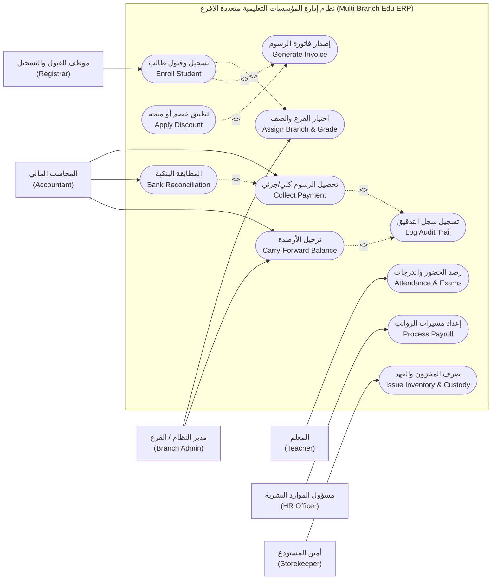
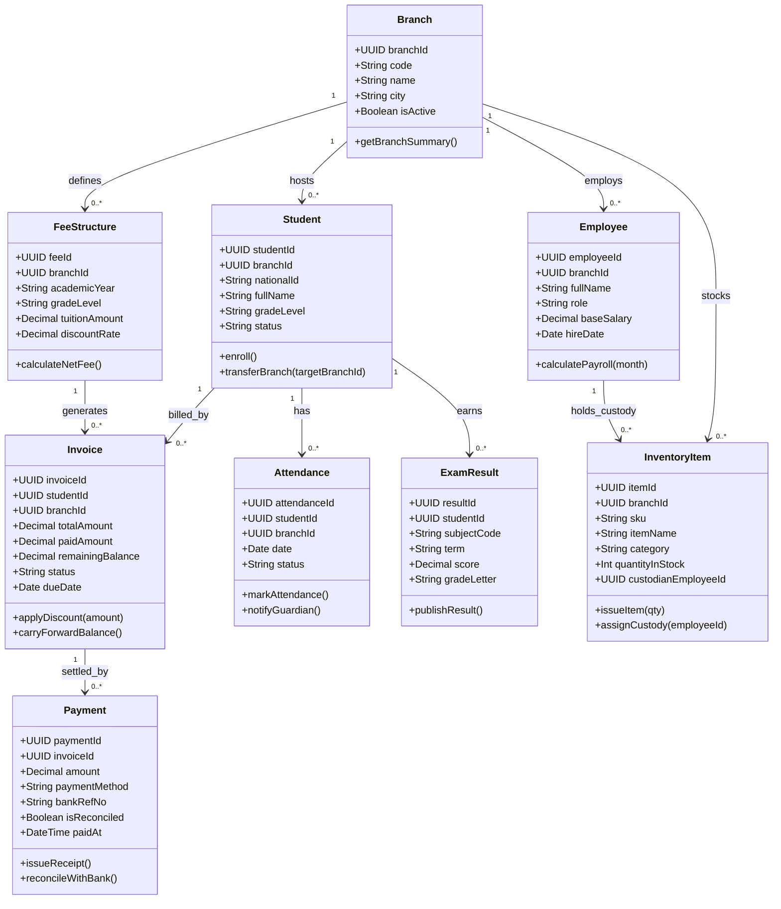
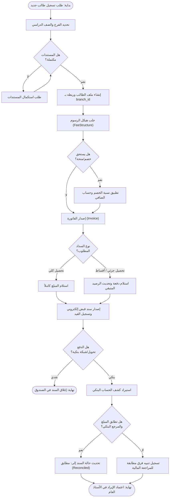
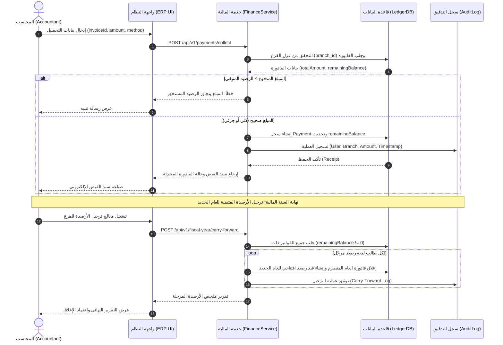
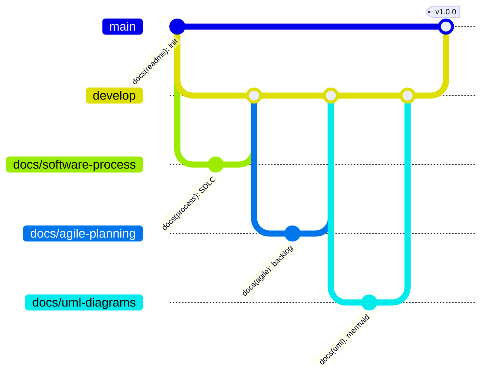

<div align="center">

# التقرير الهندسي النهائي (Final Software Engineering Report)

## نظام إدارة المؤسسات التعليمية متعددة الأفرع
### (Multi-Branch Educational ERP System)

---

| البيان | التفاصيل |
| :--- | :--- |
| **اسم الطالب (Student Name)** | [أدخل اسم الطالب هنا] |
| **الرقم الجامعي (Student ID)** | [أدخل الرقم الجامعي هنا] |
| **الجامعة (University)** | [أدخل اسم الجامعة هنا] |
| **الكلية / القسم (Faculty / Dept)** | [أدخل الكلية / القسم هنا] |
| **المقرر الدراسي (Course)** | هندسة البرمجيات (Software Engineering) |
| **إشراف (Supervised by)** | [أدخل اسم الدكتور / المشرف هنا] |
| **التاريخ (Date)** | 2026-11-25 |

---

</div>

## فهرس المحتويات (Table of Contents)

1. [هندسة العمليات البرمجية (Software Process Engineering)](#1-هندسة-العمليات-البرمجية-software-process-engineering)
2. [التخطيط الرشيق (Agile Planning & Scrum Artifacts)](#2-التخطيط-الرشيق-agile-planning--scrum-artifacts)
3. [مخططات النمذجة الموحدة (UML Diagrams)](#3-مخططات-النمذجة-الموحدة-uml-diagrams)
4. [إدارة البرمجيات والتحكم بالإصدارات (Software Configuration & Project Management)](#4-إدارة-البرمجيات-والتحكم-بالإصدارات-software-configuration--project-management)
5. [أخلاقيات هندسة البرمجيات (Software Engineering Ethics - ACM/IEEE)](#5-أخلاقيات-هندسة-البرمجيات-software-engineering-ethics---acmieee)

---
# 1. هندسة العمليات البرمجية (Software Process Engineering)

## 1.1 مقارنة بين نموذج الشلال (Waterfall) والمنهجية الرشيقة (Agile)

عند بناء نظام مؤسسي معقد مثل **نظام إدارة المؤسسات التعليمية متعددة الأفرع (Multi-Branch Educational ERP System)**، يعد اختيار نموذج دورة حياة تطوير البرمجيات (**SDLC**) قراراً استراتيجياً يؤثر مباشرة على جودة التسليم وإدارة المخاطر وتكلفة التغيير.

| معيار المقارنة | نموذج الشلال (Waterfall Model) | المنهجية الرشيقة (Agile / Scrum) |
| :--- | :--- | :--- |
| **طبيعة التسلسل** | خطي وتتابعي صارم (Linear Sequential)؛ لا تبدأ مرحلة إلا بعد اكتمال سابقتها. | تكراري وتزايدي (Iterative & Incremental)؛ تسليم أجزاء عاملة في دورات قصيرة (Sprints). |
| **المرونة مع التغيير** | منخفضة جداً؛ تعديل المتطلبات بعد مرحلة التحليل مكلف ومعقد. | عالية جداً؛ الترحيب بتغيير المتطلبات وإعادة ترتيب الأولويات في كل Sprint. |
| **مشاركة العميل** | تقتصر غالباً على بداية المشروع (جمع المتطلبات) ونهايته (الاختبار النهائي). | مستمرة في نهاية كل Sprint عبر جلسات المراجعة (Sprint Review) مع إدارات الأفرع. |
| **اكتشاف المخاطر والأخطاء** | متأخر (في مرحلة الاختبار النهائية)، مما قد يكشف أخطاء تصميمية جسيمة متأخراً. | مبكر ومستمر في كل دورة، مما يقلل المخاطر التقنية والمحاسبية. |
| **توقيت التسليم** | تسليم واحد كبير في نهاية المشروع (Big Bang Delivery). | تسليم تدريجي للوحدات ذات الأولوية (مثلاً: القبول والرسوم أولاً ثم الرواتب والمخازن). |
| **التوثيق (Documentation)** | ثقيل ومفصل مسبقاً قبل كتابة أي سطر برمجي. | متوازن وحي (Docs-as-Code) يتطور مع الكود الفعلي. |

---

## 1.2 مبررات اختيار منهجية Agile (إطار عمل Scrum)

تم اعتماد **منهجية Agile** وتحديداً إطار عمل **Scrum** للأسباب التقنية والتشغيلية التالية:

1. **تعدد الوحدات وتفاوت أولوياتها (Modular Prioritization):**
   يحتوي النظام على 4 وحدات كبرى (المالية، الأكاديمية، الموارد البشرية، المخازن). تحتاج المؤسسة التعليمية غالباً إلى إطلاق **وحدة القبول والتحصيل المالي** قبل بداية العام الدراسي، بينما يمكن تسليم **المطابقة البنكية المتقدمة** و**إدارة العهد** في مراحل لاحقة. يتيح Scrum تسليم قيمة حقيقية مبكراً (Early Value Delivery).
2. **تعقيد القواعد المالية والمحاسبية المتغيرة:**
   تختلف سياسات الخصومات، هياكل الرسوم، ولوائح الحضور والامتحانات بين فرع وآخر أو نتيجة قرارات تنظيمية جديدة. يوفر Scrum مرونة استيعاب هذه التغييرات عبر **Product Backlog Refinement** دون هدم التصميم بالكامل.
3. **التحقق المستمر من عزل البيانات (Multi-Branch Isolation):**
   يتيح الاختبار التكراري في نهاية كل Sprint التحقق المبكر من أن بيانات كل فرع معزولة أمنياً ومنطقياً (Tenant Isolation) قبل الانتقال لبناء وحدات جديدة تعتمد عليها.
4. **تقليل مخاطر التكامل (Integration Risk Mitigation):**
   نظراً لتشابك الوحدات (مثل ارتباط تسجيل الطالب بإصدار الفاتورة، وارتباط دوام الموظف بمسير الرواتب)، فإن الدمج المستمر في نهاية كل Sprint يضمن اكتشاف تعارضات واجهات البرمجة (APIs) مبكراً.

---

## 1.3 مراحل تطوير النظام الست (6-Phase SDLC)

تُنفذ دورة حياة تطوير النظام عبر 6 مراحل مترابطة تُطبق تكرارياً داخل Sprints:

### المرحلة 1: التخطيط ودراسة الجدوى (Planning & Feasibility Study)
- تحديد نطاق المشروع وأصحاب المصلحة (إدارة المؤسسة، مديرو الأفرع، المحاسبون، شؤون الطلاب، أمناء المستودعات).
- دراسة الجدوى التقنية والاقتصادية وتحديد معمارية تعدد الأفرع (**Multi-Tenancy Architecture**).
- إعداد ميثاق المشروع وتحديد أهداف الإطلاق الأولي (**MVP**).

### المرحلة 2: تحليل المتطلبات (Requirements Analysis)
- جمع المتطلبات الوظيفية (Functional Requirements) للوحدات الأربع:
  - المالية: الرسوم، الخصومات، الفواتير، التحصيل الكلي/الجزئي، المطابقة البنكية، ترحيل الأرصدة.
  - الأكاديمية: القبول، الحضور، الجداول، الامتحانات.
  - الموارد البشرية: ملفات الموظفين، الحضور، مسيرات الرواتب.
  - المخازن والعهد: المستودعات الفرعية، صرف الكتب والزي، تتبع العهد.
- تحديد المتطلبات غير الوظيفية (Non-Functional Requirements): الأمان، عزل بيانات الأفرع، الأداء، وسجلات التدقيق (**Audit Logs**).
- صياغة قصص المستخدمين (**User Stories**) ومعايير القبول (**Acceptance Criteria**).

### المرحلة 3: تصميم النظام والمعمارية (System & Architecture Design)
- تصميم قاعدة البيانات العلائقية مع تضمين مفتاح الفرع (`branch_id`) لضمان عزل البيانات.
- رسم مخططات **UML** (Use Case, Class, Activity, Sequence) لتوثيق التدفقات المعقدة مثل التحصيل الجزئي والمطابقة البنكية.
- تصميم واجهات برمجة التطبيقات (**RESTful APIs**) ونظام الصلاحيات القائم على الأدوار (**RBAC**).

### المرحلة 4: التطوير والترميز (Implementation & Development)
- تقسيم العمل إلى **Sprints** (كل Sprint مدته أسبوعان).
- تطبيق استراتيجية **GitFlow** ومعايير **Conventional Commits** لضمان تتبع التغييرات.
- بناء الوحدات البرمجية مع كتابة اختبارات الوحدة (**Unit Tests**) بالتوازي.

### المرحلة 5: الاختبار وضمان الجودة (Testing & QA)
- **اختبار التكامل (Integration Testing):** التحقق من ترابط التسجيل الأكاديمي مع الفوترة المالية.
- **اختبار الأمان والعزل (Security & Isolation Testing):** التأكد من عدم قدرة مستخدم فرع (أ) على الوصول لبيانات فرع (ب).
- **اختبار قبول المستخدم (UAT):** مراجعة المخرجات مع فريق المحاسبة وشؤون الطلاب في نهاية كل Sprint.

### المرحلة 6: النشر والصيانة والتشغيل (Deployment & Maintenance)
- نشر النظام على بيئة الإنتاج السحابية وتهيئة النسخ الاحتياطي التلقائي.
- تدريب الموظفين في الأفرع المختلفة وتوفير أدلة الاستخدام.
- المراقبة المستمرة للأداء، تطبيق التحديثات الأمنية، وتطوير التحسينات المستقبلية بناءً على تغذية المستخدمين الراجعة.

---

# 2. التخطيط الرشيق (Agile Planning & Scrum Artifacts)

## 2.1 قصص المستخدمين (User Stories) للوحدات الأربع

تمت صياغة قصص المستخدمين وفق الصيغة القياسية:
> **بصفتي [دور المستخدم]، أريد [الهدف/الوظيفة]، لكي [القيمة/الفائدة].**

### أولاً: وحدة الإدارة المالية والمحاسبية (Finance & Accounting)
- **US-FIN-01:** بصفتي **مدير مالي**، أريد تعريف هياكل الرسوم الدراسية (Fee Structures) والخصومات والمنح لكل فرع ومرحلة دراسية، لكي يتم احتساب رسوم كل طالب تلقائياً بدقة عند التسجيل.
- **US-FIN-02:** بصفتي **محاسب فرع**، أريد إصدار فواتير إلكترونية وتحصيل الرسوم كلياً أو جزئياً (أقساط) مع إصدار سندات قبض فورية، لكي أتابع المتبقي على كل طالب بمرونة.
- **US-FIN-03:** بصفتي **مراجع مالي**، أريد استيراد كشوف الحسابات البنكية وإجراء مطابقة بنكية (Bank Reconciliation) مع سندات التحصيل، لكي أكتشف أي فروقات أو حوالات غير مسجلة.
- **US-FIN-04:** بصفتي **مدير مالي**، أريد ترحيل الأرصدة الدائنة والمدينة (Balance Carry-Forward) للطلاب عند إغلاق السنة المالية، لكي تبدأ السنة الجديدة بأرصدة افتتاحية دقيقة.

### ثانياً: وحدة الإدارة الأكاديمية وشؤون الطلاب (Academic & Student Affairs)
- **US-ACA-01:** بصفتي **موظف قبول وتسجيل**، أريد تسجيل بيانات الطلاب الجدد وربطهم بفرع محدد وصف دراسي مع إمكانية النقل بين الأفرع، لكي تُحفظ سجلاتهم الأكاديمية مركزياً.
- **US-ACA-02:** بصفتي **معلم**، أريد تسجيل الحضور والغياب اليومي للطلاب عبر النظام وإرسال تنبيهات تلقائية لولي الأمر، لكي يتم ضبط الانضباط المدرسي.
- **US-ACA-03:** بصفتي **منسق أكاديمي**، أريد إنشاء الجداول الدراسية الأسبوعية وتوزيع القاعات والمعلمين دون تعارضات، لكي تنتظم العملية التعليمية في كل فرع.
- **US-ACA-04:** بصفتي **مسؤول اختبارات**، أريد رصد درجات الامتحانات الفصلية والنهائية وإصدار كشوف الدرجات والشهادات آلياً، لكي يحصل الطلاب على نتائجهم بدقة وسرعة.

### ثالثاً: وحدة إدارة الموظفين والرواتب (HR & Payroll)
- **US-HR-01:** بصفتي **مدير موارد بشرية**، أريد إدارة ملفات الموظفين وعقودهم وتعييناتهم عبر الأفرع المختلفة، لكي تتوفر قاعدة بيانات موحدة للكوادر.
- **US-HR-02:** بصفتي **محاسب رواتب**، أريد احتساب مسيرات الرواتب الشهرية (Payroll) تلقائياً بناءً على الحضور والإجازات والبدلات والاستقطاعات، لكي تُصرف الرواتب دون أخطاء يدوية.

### رابعاً: وحدة إدارة المخازن والعهد (Inventory & Assets Custody)
- **US-INV-01:** بصفتي **أمين مستودع**، أريد متابعة أرصدة الكتب والزي المدرسي والمستلزمات في كل فرع وتلقي تنبيهات عند الحد الأدنى للطلب، لكي لا يحدث عجز أثناء العام الدراسي.
- **US-INV-02:** بصفتي **مشرف إداري**، أريد تسجيل تسليم واسترجاع العهد الشخصية (مثل أجهزة الحاسوب والمعدات) للموظفين، لكي أضمن حفظ أصول المؤسسة ومساءلة حامليها.

---

## 2.2 قائمة متطلبات المنتج (Product Backlog)

| المعرف (ID) | الوحدة (Module) | عنصر الـ Backlog (User Story / Epic) | الأولوية (Priority) | نقاط القصة (Story Points) | السبرنت المستهدف |
| :--- | :--- | :--- | :--- | :---: | :---: |
| **PB-01** | النواة (Core) | تهيئة بنية تعدد الأفرع (Multi-Branch Isolation) ونظام الصلاحيات (RBAC) | Critical | 8 | Sprint 1 |
| **PB-02** | الأكاديمية | بوابة القبول والتسجيل وربط الطالب بالفرع والصف الدراسي | High | 8 | Sprint 1 |
| **PB-03** | المالية | تعريف هياكل الرسوم (Fee Structures) والخصومات والمنح | High | 5 | Sprint 1 |
| **PB-04** | المالية | إصدار الفواتير وتحصيل الرسوم (كلي / جزئي) وسندات القبض | Critical | 8 | Sprint 2 |
| **PB-05** | الأكاديمية | نظام الحضور والغياب اليومي للطلاب والتنبيهات | High | 5 | Sprint 2 |
| **PB-06** | الأكاديمية | إدارة الجداول الدراسية ومنع تعارض القاعات والمعلمين | Medium | 8 | Sprint 2 |
| **PB-07** | المالية | المطابقة البنكية (Bank Reconciliation) واستيراد كشوف البنك | High | 8 | Sprint 3 |
| **PB-08** | الأكاديمية | إدارة الامتحانات ورصد الدرجات وإصدار الشهادات | High | 8 | Sprint 3 |
| **PB-09** | الموارد البشرية | ملفات الموظفين والعقود وسجلات الدوام عبر الأفرع | Medium | 5 | Sprint 3 |
| **PB-10** | المالية | ترحيل الأرصدة (Balance Carry-Forward) وإغلاق السنة المالية | High | 5 | Sprint 4 |
| **PB-11** | الموارد البشرية | احتساب مسيرات الرواتب (Payroll) والبدلات والاستقطاعات | High | 8 | Sprint 4 |
| **PB-12** | المخازن والعهد | إدارة المخازن الفرعية، صرف الكتب/الزي، وتتبع العهد | Medium | 8 | Sprint 4 |

**إجمالي نقاط القصة (Total Story Points):** 84 نقطة موزعة على 4 سبرنتات (بمتوسط سرعة فريق **Velocity = 21 نقطة/سبرنت**).

---

## 2.3 خطة الـ 4 Sprints (4-Sprint Release Plan)

مدة كل Sprint هي **أسبوعان (14 يوماً)**، وتُختتم باجتماع **Sprint Review** لعرض المنجزات و**Sprint Retrospective** لتحسين الأداء.

### Sprint 1: الأساس المعماري والقبول وهيكلة الرسوم (21 نقطة)
- **الهدف (Sprint Goal):** تأسيس بيئة العمل متعددة الأفرع مع عزل البيانات، وتمكين تسجيل الطلاب وتحديد خططهم المالية.
- **العناصر:** `PB-01` (8)، `PB-02` (8)، `PB-03` (5).
- **المخرجات القابلة للتسليم:** لوحة تحكم الإدارة العليا لإضافة الأفرع، شاشة قبول الطلاب، وشاشة إعداد الرسوم والخصومات.

### Sprint 2: التحصيل المالي والعمليات الأكاديمية اليومية (21 نقطة)
- **الهدف (Sprint Goal):** تفعيل الدورة المالية الأساسية (فوترة وتحصيل) وتشغيل الحضور والجداول اليومية.
- **العناصر:** `PB-04` (8)، `PB-05` (5)، `PB-06` (8).
- **المخرجات القابلة للتسليم:** نظام الفواتير والتحصيل الجزئي/الكلي، رصد الغياب، وبناء الجداول الدراسية.

### Sprint 3: المطابقة البنكية، الامتحانات، وملفات الموظفين (21 نقطة)
- **الهدف (Sprint Goal):** إغلاق الحلقة الرقابية المالية عبر المطابقة البنكية، وإتمام دورة التقييم الأكاديمي، وتأسيس قاعدة الموارد البشرية.
- **العناصر:** `PB-07` (8)، `PB-08` (8)، `PB-09` (5).
- **المخرجات القابلة للتسليم:** وحدة المطابقة البنكية، بوابة الدرجات والشهادات، وملفات الموظفين.

### Sprint 4: الإغلاق المالي، الرواتب، والمخازن والعهد (21 نقطة)
- **الهدف (Sprint Goal):** إتمام جاهزية النظام للإغلاق السنوي، صرف الرواتب، والرقابة على المخزون والأصول.
- **العناصر:** `PB-10` (5)، `PB-11` (8)، `PB-12` (8).
- **المخرجات القابلة للتسليم:** آلية ترحيل الأرصدة، محرك مسيرات الرواتب، ونظام المخازن والعهد.

---

# 3. مخططات النمذجة الموحدة (UML Diagrams)

تم تصميم جميع المخططات باستخدام لغة **Mermaid** القياسية لتعمل وتُعرض تلقائياً داخل GitHub وأدوات التوثيق الحديثة (Docs-as-Code).

---

## 3.1 مخطط حالات الاستخدام (Use Case Diagram)

يوضح المخطط التالي التفاعلات الرئيسية بين الفاعلين (Actors) والنظام، مع إبراز علاقات التضمين (`<<include>>`) والامتداد (`<<extend>>`).



---

## 3.2 مخطط الفئات (Class Diagram)

يمثل المخطط الكيانات الأساسية للنظام في الوحدات الأربع، مع ربطها بكيان الفرع (`Branch`) لضمان عزل البيانات (Multi-Branch Isolation).



---

## 3.3 مخطط النشاط (Activity Diagram)
### دورة التسجيل وتحصيل الرسوم والمطابقة البنكية



---

## 3.4 مخطط التتابع (Sequence Diagram)
### عملية تحصيل الرسوم وترحيل الرصيد (Fee Collection & Balance Carry-Forward)



---

# 4. إدارة البرمجيات والتحكم بالإصدارات (Software Configuration & Project Management)

## 4.1 استراتيجية الفروع (GitFlow Strategy)

لضمان استقرار النظام أثناء التطوير المتوازي للوحدات الأربع (المالية، الأكاديمية، الموارد البشرية، المخازن)، يعتمد المشروع نموذج **GitFlow** المنظم للفروع:

| نوع الفرع | التسمية (Naming) | الغرض | يتفرع من | يُدمج في |
| :--- | :--- | :--- | :--- | :--- |
| **الفرع الرئيسي** | `main` | يضم النسخ المستقرة الجاهزة للإنتاج (Production-Ready) فقط. | — | — |
| **فرع التطوير** | `develop` | فرع التكامل الرئيسي الذي يجمع كافة الميزات المكتملة قبل الإطلاق. | `main` | `main` (عبر `--no-ff`) |
| **فروع الميزات/التوثيق** | `feature/*` أو `docs/*` | تطوير ميزة جديدة أو قسم توثيق مستقل (مثل `docs/uml-diagrams`). | `develop` | `develop` (عبر `--no-ff`) |
| **فروع الإطلاق** | `release/vX.Y.Z` | تجهيز الإصدار، الاختبارات النهائية، وتحديث أرقام النسخ. | `develop` | `main` و `develop` |
| **فروع الإصلاح العاجل** | `hotfix/*` | إصلاح الأخطاء الحرجة في بيئة الإنتاج فوراً. | `main` | `main` و `develop` |

> **ملاحظة هندسية:** يتم استخدام خيار `--no-ff` (No Fast-Forward) عند دمج الفروع للحفاظ على سجل تاريخي واضح (Explicit Merge Commit) يظهر بنية الفروع بوضوح في الـ **Git Graph**.



---

## 4.2 معايير رسائل الالتزام (Conventional Commits)

يلتزم فريق التطوير والتوثيق بمواصفة **Conventional Commits** لتوحيد سجل التغييرات وتسهيل توليد سجل الإصدارات (`CHANGELOG.md`) آلياً:

### الصيغة القياسية:
```text
<type>(<scope>): <short description>
```

### الأنواع المعتمدة (Commit Types):
- **`feat`**: إضافة ميزة جديدة للنظام (مثال: `feat(finance): add partial payment receipt generation`).
- **`fix`**: إصلاح خطأ برمجي (مثال: `fix(auth): enforce branch_id isolation in middleware`).
- **`docs`**: إضافة أو تحديث التوثيق (مثال: `docs(uml): add use case, class, activity, and sequence diagrams`).
- **`refactor`**: إعادة هيكلة الكود دون تغيير السلوك الخارجي.
- **`test`**: إضافة أو تعديل اختبارات الوحدة والتكامل.
- **`chore`**: مهام الصيانة، السكربتات، وإعدادات البناء (مثال: `chore(scripts): add GitHub issues setup script`).

---

## 4.3 إدارة المهام عبر لوحة كانبان (Kanban Board)

تُدار مهام الـ Sprints عبر **GitHub Projects (Kanban Board)** لتوفير شفافية كاملة لتقدم العمل عبر الأعمدة الخمسة التالية:

1. **Product Backlog:** جميع المتطلبات والمهام المخطط لها والمصنفة حسب الأولوية (`Critical`, `High`, `Medium`).
2. **To Do (Sprint Ready):** المهام المختارة للـ Sprint الحالي والجاهزة للتنفيذ.
3. **In Progress (WIP Limit: 3):** المهام قيد التطوير أو التوثيق حالياً (مع تحديد حد أقصى للعمل الجاري لمنع التشتت).
4. **In Review:** المهام التي فُتح لها Pull Request وتنتظر مراجعة الأقران (Peer Review) والتحقق من اختبارات الجودة.
5. **Done:** المهام المكتملة والمُدمجة في فرع `develop`.

---

## 4.4 التوثيق البصري (لقطات الشاشة - Screenshots Placeholders)

> **[مكان مخصص لإدراج لقطات الشاشة بعد الرفع على GitHub]**

1. **لقطة شاشة لمخطط الفروع (Git Graph / Insights -> Network):**
   - *الوصف:* توضح تفرع `docs/*` من `develop` ودمجها باستخدام `--no-ff` ثم الدمج النهائي في `main`.
   - `<!-- TODO: أدرج صورة Git Graph هنا:  -->`

2. **لقطة شاشة للوحة كانبان (GitHub Projects - Kanban Board):**
   - *الوصف:* توضح توزيع عناصر الـ Product Backlog بين الأعمدة (`To Do`, `In Progress`, `In Review`, `Done`) مع Labels الوحدات والأولويات.
   - `<!-- TODO: أدرج صورة Kanban Board هنا:  -->`

---

# 5. أخلاقيات هندسة البرمجيات (Software Engineering Ethics - ACM/IEEE)

يلتزم فريق تطوير **نظام إدارة المؤسسات التعليمية متعددة الأفرع (Multi-Branch Educational ERP System)** بميثاق **ACM/IEEE لأخلاقيات هندسة البرمجيات والممارسة المهنية**، نظراً لحساسية البيانات التي يعالجها النظام (بيانات الطلاب القُصّر، السجلات الأكاديمية، المعاملات المالية، ورواتب الموظفين).

---

## 5.1 الخصوصية وعزل بيانات الأفرع (Privacy & Multi-Branch Data Isolation)

وفقاً لمبدأ **المصلحة العامة (Public)** ومبدأ **المنتج (Product)** في ميثاق ACM/IEEE:
- **عزل البيانات الصارم (Strict Tenant/Branch Isolation):** يجب فرض عزل منطقي وأمني تام لبيانات كل فرع عبر ربط كافة الاستعلامات بمعرف الفرع (`branch_id`) وتطبيق سياسات **Row-Level Security (RLS)**، بحيث يُمنع موظفو أو محاسبو فرع معين من الاطلاع على بيانات طلاب أو رواتب فرع آخر.
- **الحد الأدنى من الصلاحيات (Principle of Least Privilege):** يقتصر وصول كل مستخدم على ما تحتاجه وظيفته فقط عبر نظام **RBAC** (فالمعلم يرى الحضور والدرجات دون الاطلاع على الوضع المالي لولي الأمر، والمحاسب يرى الفواتير دون الاطلاع على التقارير السلوكية).
- **حماية خصوصية القُصّر وأولياء الأمور:** تشفير بيانات الهوية الوطنية وأرقام التواصل والبيانات البنكية أثناء التخزين (**Encryption at Rest - AES-256**) وأثناء النقل (**TLS 1.3**).

---

## 5.2 حماية البيانات وسجلات التدقيق (Data Protection & Audit Logs)

وفقاً لمبدأ **النزاهة المهنية (Judgment)** ومبدأ **الإدارة (Management)**:
- **سجلات تدقيق غير قابلة للتعديل (Immutable Audit Logs):** أي عملية حساسة في النظام — مثل تعديل درجة امتحان، تطبيق خصم مالي، إلغاء فاتورة، تحصيل دفعة، أو ترحيل أرصدة — تُسجل تلقائياً في جدول تدقيق محمي يتضمن: (`user_id`, `branch_id`, `action`, `old_value`, `new_value`, `ip_address`, `timestamp`).
- **منع الحذف الفيزيائي للسجلات المالية والأكاديمية (Soft Delete Only):** يُمنع حذف الفواتير أو سندات القبض أو كشوف الدرجات نهائياً من قاعدة البيانات، وتُعالج الأخطاء عبر قيود عكسية (Reversal Entries) موثقة لضمان الشفافية المحاسبية ومكافحة التلاعب المالي.
- **النسخ الاحتياطي والتعافي من الكوارث (Backup & Disaster Recovery):** جدولة نسخ احتياطية مشفرة يومياً مع اختبار دوري لاستعادتها لضمان استمرارية الخدمة التعليمية والمالية.

---

## 5.3 الملكية الفكرية (Intellectual Property)

وفقاً لمبدأ **العميل وصاحب العمل (Client and Employer)** ومبدأ **المهنة (Profession)**:
- **احترام تراخيص البرمجيات مفتوحة المصدر (Open-Source Licensing):** الالتزام الكامل بشروط تراخيص المكتبات والأطر البرمجية المستخدمة (مثل MIT وApache 2.0) وتوثيقها في ملف التراخيص، وتجنب استخدام مكتبات ذات تراخيص متعارضة دون موافقة قانونية.
- **ملكية المؤسسة التعليمية للبيانات والكود المخصص:** تظل كافة البيانات الأكاديمية والمالية وبيانات الموظفين ملكاً حصرياً للمؤسسة التعليمية، مع تمكينها من تصدير بياناتها بصيغ قياسية (CSV, JSON, PDF) دون احتكار (No Vendor Lock-in).
- **حماية الشيفرة المصدرية:** منع تسريب الشيفرة المصدرية أو مفاتيح الربط البرمجي (API Keys) عبر مستودعات عامة، واستخدام متغيرات البيئة وإدارة الأسرار (Secrets Management).

---

## 5.4 الاستخدام المسؤول والنزاهة التقنية (Responsible Use)

وفقاً لمبدأ **الذات (Self)** ومبدأ **الزملاء (Colleagues)**:
- **النزاهة الأكاديمية والمالية:** عدم برمجة أي أبواب خلفية (Backdoors) أو صلاحيات مخفية تسمح بتعديل الدرجات أو الأرصدة المالية خارج مسار الاعتماد الرسمي.
- **الشفافية في الأتمتة والتنبيهات:** عند إرسال تنبيهات آلية لولي الأمر حول الغياب أو تأخر الأقساط، يجب أن تكون الرسائل دقيقة ومهنية وتحفظ كرامة الطالب وولي الأمر دون تشهير.
- **إتاحة الوصول (Accessibility):** تصميم واجهات النظام وفق معايير **WCAG** لتكون قابلة للاستخدام من قِبل جميع الموظفين وأولياء الأمور بمن فيهم ذوو الاحتياجات الخاصة.
