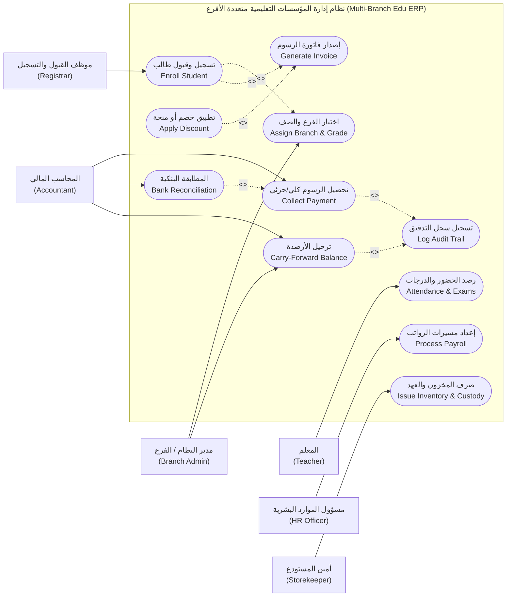
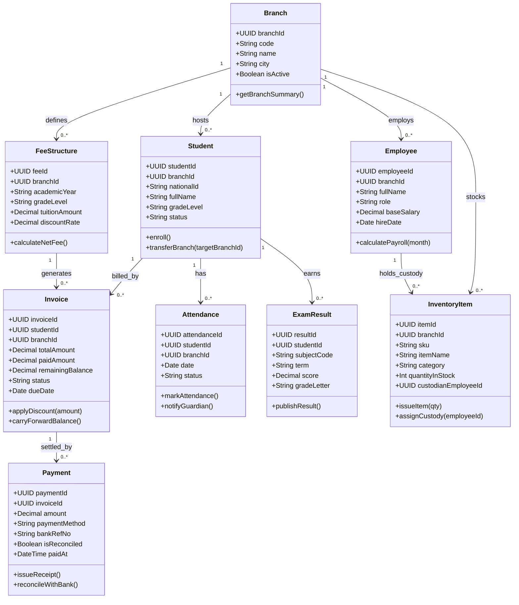
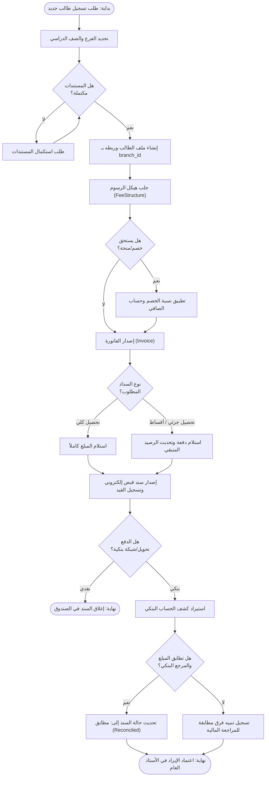
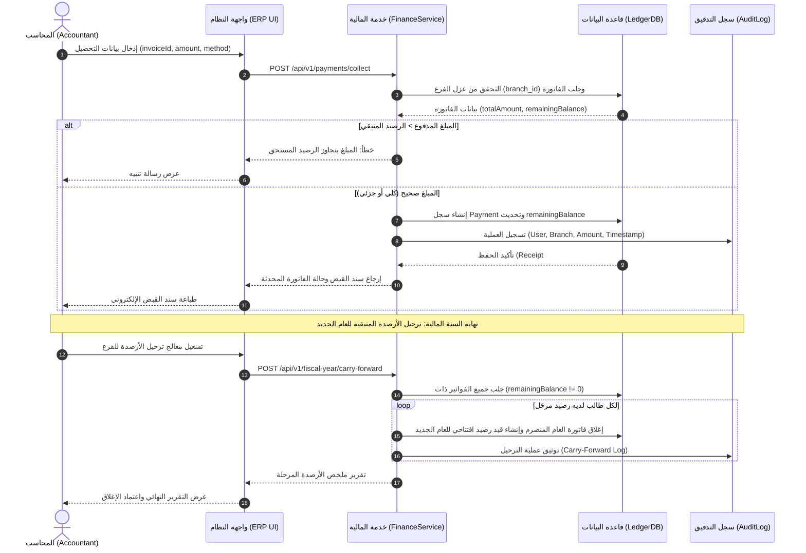

# 3. مخططات النمذجة الموحدة (UML Diagrams)

تم تصميم جميع المخططات باستخدام لغة **Mermaid** القياسية لتعمل وتُعرض تلقائياً داخل GitHub وأدوات التوثيق الحديثة (Docs-as-Code).

---

## 3.1 مخطط حالات الاستخدام (Use Case Diagram)

يوضح المخطط التالي التفاعلات الرئيسية بين الفاعلين (Actors) والنظام، مع إبراز علاقات التضمين (`<<include>>`) والامتداد (`<<extend>>`).

---

## 3.2 مخطط الفئات (Class Diagram)

يمثل المخطط الكيانات الأساسية للنظام في الوحدات الأربع، مع ربطها بكيان الفرع (`Branch`) لضمان عزل البيانات (Multi-Branch Isolation).

---

## 3.3 مخطط النشاط (Activity Diagram)
### دورة التسجيل وتحصيل الرسوم والمطابقة البنكية

---

## 3.4 مخطط التتابع (Sequence Diagram)
### عملية تحصيل الرسوم وترحيل الرصيد (Fee Collection & Balance Carry-Forward)

