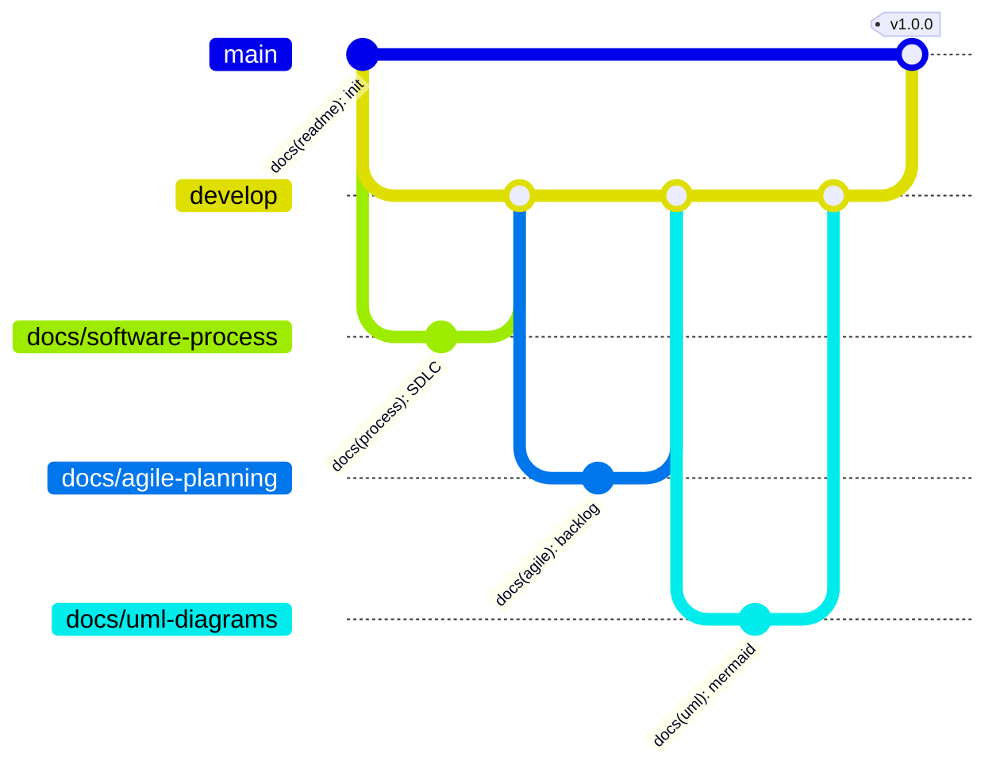
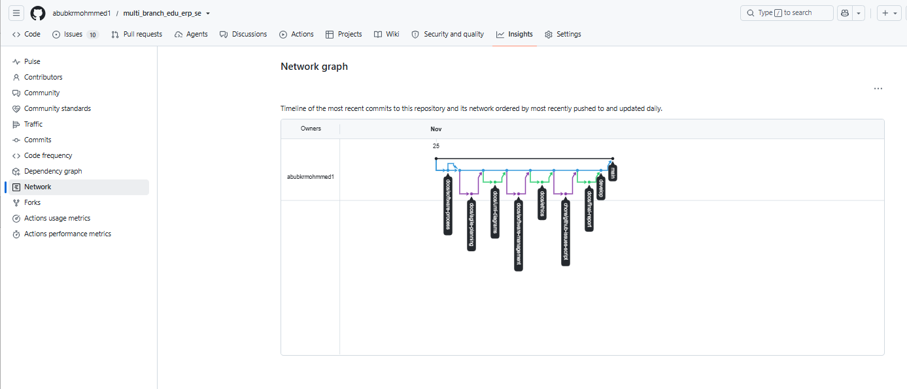
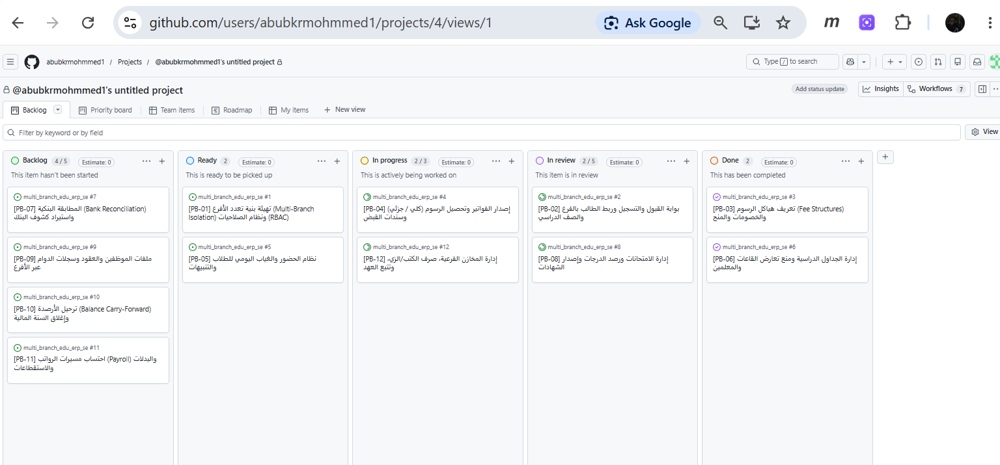

# 4. إدارة البرمجيات والتحكم بالإصدارات (Software Configuration & Project Management)

## 4.1 استراتيجية الفروع (GitFlow Strategy)

لضمان استقرار النظام أثناء التطوير المتوازي للوحدات الأربع (المالية، الأكاديمية، الموارد البشرية، المخازن)، يعتمد المشروع نموذج **GitFlow** المنظم للفروع:

| نوع الفرع | التسمية (Naming) | الغرض | يتفرع من | يُدمج في |
| :--- | :--- | :--- | :--- | :--- |
| **الفرع الرئيسي** | `main` | يضم النسخ المستقرة الجاهزة للإنتاج (Production-Ready) فقط. | — | — |
| **فرع التطوير** | `develop` | فرع التكامل الرئيسي الذي يجمع كافة الميزات المكتملة قبل الإطلاق. | `main` | `main` (عبر `--no-ff`) |
| **فروع الميزات/التوثيق** | `feature/*` أو `docs/*` | تطوير ميزة جديدة أو قسم توثيق مستقل (مثل `docs/uml-diagrams`). | `develop` | `develop` (عبر `--no-ff`) |
| **فروع الإطلاق** | `release/vX.Y.Z` | تجهيز الإصدار، الاختبارات النهائية، وتحديث أرقام النسخ. | `develop` | `main` و `develop` |
| **فروع الإصلاح العاجل** | `hotfix/*` | إصلاح الأخطاء الحرجة في بيئة الإنتاج فوراً. | `main` | `main` و `develop` |

> **ملاحظة هندسية:** يتم استخدام خيار `--no-ff` (No Fast-Forward) عند دمج الفروع للحفاظ على سجل تاريخي واضح (Explicit Merge Commit) يظهر بنية الفروع بوضوح في الـ **Git Graph**.



---

## 4.2 معايير رسائل الالتزام (Conventional Commits)

يلتزم فريق التطوير والتوثيق بمواصفة **Conventional Commits** لتوحيد سجل التغييرات وتسهيل توليد سجل الإصدارات (`CHANGELOG.md`) آلياً:

### الصيغة القياسية:
```text
<type>(<scope>): <short description>
```

### الأنواع المعتمدة (Commit Types):
- **`feat`**: إضافة ميزة جديدة للنظام (مثال: `feat(finance): add partial payment receipt generation`).
- **`fix`**: إصلاح خطأ برمجي (مثال: `fix(auth): enforce branch_id isolation in middleware`).
- **`docs`**: إضافة أو تحديث التوثيق (مثال: `docs(uml): add use case, class, activity, and sequence diagrams`).
- **`refactor`**: إعادة هيكلة الكود دون تغيير السلوك الخارجي.
- **`test`**: إضافة أو تعديل اختبارات الوحدة والتكامل.
- **`chore`**: مهام الصيانة، السكربتات، وإعدادات البناء (مثال: `chore(scripts): add GitHub issues setup script`).

---

## 4.3 إدارة المهام عبر لوحة كانبان (Kanban Board)

تُدار مهام الـ Sprints عبر **GitHub Projects (Kanban Board)** لتوفير شفافية كاملة لتقدم العمل عبر الأعمدة الخمسة التالية:

1. **Product Backlog:** جميع المتطلبات والمهام المخطط لها والمصنفة حسب الأولوية (`Critical`, `High`, `Medium`).
2. **To Do (Sprint Ready):** المهام المختارة للـ Sprint الحالي والجاهزة للتنفيذ.
3. **In Progress (WIP Limit: 3):** المهام قيد التطوير أو التوثيق حالياً (مع تحديد حد أقصى للعمل الجاري لمنع التشتت).
4. **In Review:** المهام التي فُتح لها Pull Request وتنتظر مراجعة الأقران (Peer Review) والتحقق من اختبارات الجودة.
5. **Done:** المهام المكتملة والمُدمجة في فرع `develop`.

---

## 4.4 التوثيق البصري (لقطات الشاشة - Screenshots)

1. **لقطة شاشة لمخطط الفروع (Git Graph / Insights -> Network):**
   - *الوصف:* توضح تفرع `docs/*` من `develop` ودمجها باستخدام `--no-ff` ثم الدمج النهائي في `main`.

   

2. **لقطة شاشة للوحة كانبان (GitHub Projects - Kanban Board):**
   - *الوصف:* توضح توزيع عناصر الـ Product Backlog بين الأعمدة (`Backlog`, `Ready`, `In progress`, `In review`, `Done`) مع ربطها بالـ Issues.

   
